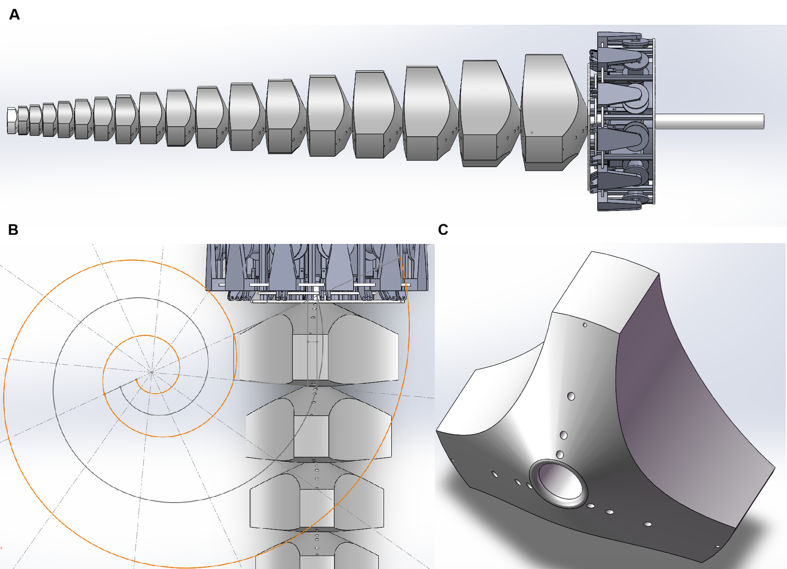

# Multi-Segment Logarithmic Spiral Continuum Robot

[](LICENSE)
[](https://www.python.org/)
[](paper/A_Multi_Segment_Logarithmic_Spiral_Continuum_Robot.pdf)

Official code, mechanical CAD models, experimental datasets, and paper source for:

> **A Multi-Segment Logarithmic Spiral Continuum Robot with a Stretchable Central Backbone: Design and Coupled Kinematic Modeling**  
> Huaicheng Huang, Pingsong Deng, Guolei Wang*
> *EECR 2026*
> https://doi.org/10.1109/EECR69522.2026.11548958

<p align="center">
  
</p>

## Overview

We present a **4-segment, 12-DoF** bio-inspired continuum robot (~80 cm total length) built around a **logarithmic spiral joint geometry** ($\rho(\theta) = a \cdot e^{b\theta}$) and a **stretchable PTFE central elastic backbone**. To map high-level segment bending commands $(\phi_i, \theta_i)$ to cable-driven Feetech serial bus servos, we implement:

- **Segment-specific coupled inverse kinematics** (`src/kinematics/`) with dynamic backbone length compensation (`L_actual_straight` $\rightarrow$ `L_ideal_straight`).
- **Inter-segment coupling compensation** (`coupling_factor = 0.8` applied to distal passive segments in `src/robot_control.py`).
- **Piecewise Constant Curvature (PCC) forward kinematics** (`src/location.py`) outputting cylindrical $(r, \phi, z)$ coordinates for validation.
- **Software multi-turn absolute position tracking** (`src/multi_turn_handler.py`) extending single-turn `0–4095` servo registers to multi-revolution cable actuation.

---

## Repository Structure

```text
Multi-Segment-Logarithmic-Spiral-Continuum-Robot/
├── README.md
├── LICENSE
├── requirements.txt
├── src/
│   ├── robot_control.py          # Main 12-DoF coupled kinematic hardware controller
│   ├── location.py               # PCC forward kinematics (cartesian & cylindrical)
│   ├── multi_turn_handler.py     # Multi-turn absolute step tracker for serial servos
│   ├── kinematics/               # Segment 1–4 inverse kinematic models
│   │   ├── kinematics_segment_1.py
│   │   ├── kinematics_segment_2.py
│   │   ├── kinematics_segment_3.py
│   │   └── kinematics_segment_4.py
│   ├── scservo_sdk/              # Feetech SMS/STS serial bus servo Python SDK
│   ├── examples/                 # Low-level servo examples & pygame teleop interface
│   └── analysis/
│       └── error_distance.py     # 3D positioning error analysis from CSV logs
├── cad/
│   ├── solidworks/               # Native SolidWorks assemblies (.SLDASM) & parts (.SLDPRT)
│   ├── step_dxf/                 # Neutral STEP and 2D DXF files
│   ├── machining/                # Aluminum machining package
│   └── stl/                      # 3D-printable STL meshes (distributed via GitHub Releases)
├── experiments/
│   ├── data/                     # Segment 1–4 theoretical vs. measured CSV & XLSX logs
│   └── media/                    # Prototype test photos and demonstration clips
├── paper/
│   ├── A_Multi_Segment_Logarithmic_Spiral_Continuum_Robot.pdf
│   ├── figures/                  # High-level design & joint illustrations
│   └── latex/                    # IEEEtran LaTeX source & assets
└── docs/
    └── stiffness_derivation.md   # Static bending stiffness (Kb = E * I) notes
```

---

## Hardware & Software Setup

### 1. Hardware Specifications
- **Actuation**: 12 × Feetech STS/SMS serial bus servos (`1000000` bps), 3 cables per segment (`0°`, `120°`, `240°`), `20 mm` spool diameter, `4095` steps/rev:
  - Segment 1 (Base): IDs `[11, 12, 13]`, max bend $90^\circ$
  - Segment 2: IDs `[21, 22, 23]`, max bend $120^\circ$
  - Segment 3: IDs `[31, 32, 33]`, max bend $150^\circ$
  - Segment 4 (Tip): IDs `[41, 42, 43]`, max bend $180^\circ$
- **Backbone**: Stretchable PTFE hollow tube ($d = 4\text{ mm}$, $D = 6\text{ mm}$).
- **Spiral Parameters**: $a = 2.0$, $b = 0.1764$, $\Delta\theta = \pi / 6$.

### 2. Installation
```bash
git clone https://github.com/HankinHuang/Multi-Segment-Logarithmic-Spiral-Continuum-Robot.git
cd Multi-Segment-Logarithmic-Spiral-Continuum-Robot
pip install -r requirements.txt
```

---

## Quick Start

### Forward Kinematics Simulation (No Hardware Required)
```bash
python src/location.py
```

### Single-Segment Inverse Kinematics Check
```bash
python src/kinematics/kinematics_segment_1.py
```

### Physical Robot Control
Update `PORT_NAME` (e.g., `'COM3'` on Windows or `'/dev/ttyUSB0'` on Linux) in `src/robot_control.py`, connect power and USB-TTL adapter, then run:
```bash
python src/robot_control.py
```
Interactive console commands: `move`, `home`, `status`, `quit`.

### Positioning Error Evaluation
Compute 3D Euclidean positioning error statistics for experimental data in `experiments/data/`:
```bash
python src/analysis/error_distance.py --segment 4
```

---

## CAD & 3D-Printable STL Files

- **Native SolidWorks & Neutral CAD**: Located directly in `cad/solidworks/` and `cad/step_dxf/`. Open `cad/solidworks/总体设计.SLDASM` for the full assembly.
- **STL Meshes (~482 MB)**: Due to GitHub repository size limits, the 27 `.STL` files are packaged in **GitHub Releases** rather than tracked in Git history. See [`cad/stl/README.md`](cad/stl/README.md).

---

## Citation

If you find this work useful in your research, please cite:

```bibtex
@inproceedings{huang2026logarithmic,
  title     = {A Multi-Segment Logarithmic Spiral Continuum Robot with a Stretchable Central Backbone: Design and Coupled Kinematic Modeling},
  author    = {Huang, Huaicheng and Wang, Guolei and Chen, Ken},
  booktitle = {Proceedings of EECR 2026},
  year      = {2026}
}
```

---

## 中文简介

本项目为论文 *A Multi-Segment Logarithmic Spiral Continuum Robot with a Stretchable Central Backbone: Design and Coupled Kinematic Modeling* 的配套开源仓库，包含四段 12 自由度对数螺旋连续体机器人的耦合运动学控制代码、SolidWorks 机械设计图纸、样机定位误差实验数据及 IEEEtran LaTeX 论文源码。

- **控制与运动学核心 (`src/`)**：包含面向四段结构的分段逆运动学补偿模型（`src/kinematics/`）、基于分段常曲率（PCC）的正向运动学验证（`src/location.py`）、飞特串行总线舵机多圈绝对位置跟踪控制器（`src/multi_turn_handler.py`）以及主控台程序（`src/robot_control.py`）。
- **机械结构与打印件 (`cad/`)**：仓库内直接包含 SolidWorks 装配体/零件源文件与 STEP/DXF 中性格式；体积较大的 3D 打印 `.STL` 模型通过 GitHub Releases 分发。
- **实验数据与误差分析 (`experiments/`, `src/analysis/`)**：提供四段样机理论与实测圆柱坐标 CSV 数据，可通过 `python src/analysis/error_distance.py --segment 4` 复现三维定位误差统计。
