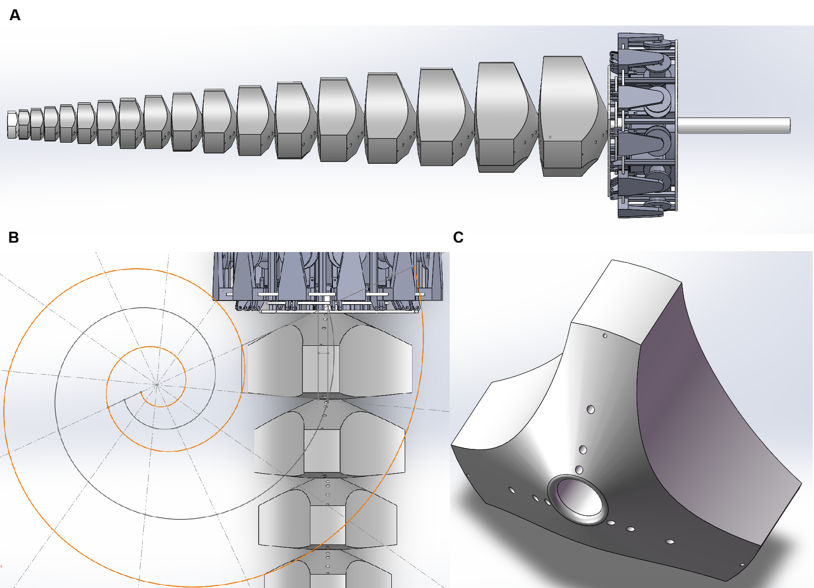

# 多段对数螺旋连续体机器人 (Multi-Segment Logarithmic Spiral Continuum Robot)

[](LICENSE)
[](https://www.python.org/)
[](paper/A_Multi_Segment_Logarithmic_Spiral_Continuum_Robot.pdf)

[English](README.md) | **简体中文**

本仓库为以下论文的官方开源代码、机械 CAD 模型、实验数据集及论文源码：

> **A Multi-Segment Logarithmic Spiral Continuum Robot with a Stretchable Central Backbone: Design and Coupled Kinematic Modeling**  
> Huaicheng Huang, Pingsong Deng, Guolei Wang*  
> *EECR 2026*  
> https://doi.org/10.1109/EECR69522.2026.11548958

<p align="center">
  
</p>

## 项目概述

我们提出并实现了一款基于**对数螺旋关节几何**（$\rho(\theta) = a \cdot e^{b\theta}$）与**可伸缩 PTFE 中心弹性骨架**的**四段、12 自由度**仿生连续体机器人（总长约 80 cm）。为将高层次的分段弯曲指令 $(\phi_i, \theta_i)$ 精确映射至绳驱飞特（Feetech）串行总线舵机控制，本仓库实现了：

- **分段耦合逆向运动学模型**（`src/kinematics/`）：引入动态中心骨架长度补偿（`L_actual_straight` $\rightarrow$ `L_ideal_straight`）。
- **段间耦合效应补偿**（`src/robot_control.py`）：在主控解算中对远端被动受影响段施加耦合折减系数（`coupling_factor = 0.8`）。
- **分段常曲率（PCC）正向运动学验证**（`src/location.py`）：输出柱坐标系 $(r, \phi, z)$ 位姿用于理论与实测对比验证。
- **软件多圈绝对位置追踪控制器**（`src/multi_turn_handler.py`）：将舵机单圈 `0–4095` 位置寄存器扩展为支持多圈绳索收放的绝对步数追踪。

---

## 仓库目录结构

```text
Multi-Segment-Logarithmic-Spiral-Continuum-Robot/
├── README.md                     # 英文主文档
├── README_CN.md                  # 中文对照文档
├── LICENSE                       # MIT 开源协议
├── requirements.txt              # Python 依赖清单
├── src/
│   ├── robot_control.py          # 12 自由度耦合运动学硬件主控程序
│   ├── location.py               # PCC 正向运动学计算（笛卡尔 / 柱坐标）
│   ├── multi_turn_handler.py     # 串行舵机多圈绝对步数追踪器
│   ├── kinematics/               # 第 1–4 段逆向运动学模型
│   │   ├── kinematics_segment_1.py
│   │   ├── kinematics_segment_2.py
│   │   ├── kinematics_segment_3.py
│   │   └── kinematics_segment_4.py
│   ├── scservo_sdk/              # 飞特 SMS/STS 串行总线舵机 Python SDK
│   ├── examples/                 # 底层舵机读写例程与 pygame 遥操作界面
│   └── analysis/
│       └── error_distance.py     # 基于 CSV 数据的三维定位误差分析脚本
├── cad/
│   ├── solidworks/               # SolidWorks 原生装配体 (.SLDASM) 与零件 (.SLDPRT)
│   ├── step_dxf/                 # STEP 与 2D DXF 中性格式文件
│   ├── machining/                # 硬铝结构件加工资料包
│   └── stl/                      # 3D 打印 STL 网格模型（通过 GitHub Releases 分发）
├── experiments/
│   ├── data/                     # 第 1–4 段理论与实测定位数据（CSV / XLSX / PDF）
│   └── media/                    # 样机实验照片与演示视频
├── paper/
│   ├── A_Multi_Segment_Logarithmic_Spiral_Continuum_Robot.pdf
│   ├── figures/                  # 机械设计与关节结构高清插图
│   └── latex/                    # IEEEtran 会议论文 LaTeX 源码与插图资源
└── docs/
    └── stiffness_derivation.md   # 中心骨架静态抗弯刚度（Kb = E * I）推导说明
```

---

## 硬件规格与环境配置

### 1. 硬件参数
- **驱动执行器**：12 个飞特 STS/SMS 串行总线舵机（波特率 `1000000` bps），每段 3 根驱动绳（周向间隔 `0°`、`120°`、`240°`），线轴直径 `20 mm`，每圈 `4095` 步：
  - 第 1 段（基座端）：舵机 ID `[11, 12, 13]`，最大弯曲角 $90^\circ$
  - 第 2 段：舵机 ID `[21, 22, 23]`，最大弯曲角 $120^\circ$
  - 第 3 段：舵机 ID `[31, 32, 33]`，最大弯曲角 $150^\circ$
  - 第 4 段（末端）：舵机 ID `[41, 42, 43]`，最大弯曲角 $180^\circ$
- **中心弹性骨架**：可伸缩 PTFE（聚四氟乙烯）空心软管（内径 $d = 4\text{ mm}$，外径 $D = 6\text{ mm}$）。
- **对数螺旋参数**：$a = 2.0$，$b = 0.1764$，$\Delta\theta = \pi / 6$。

### 2. 环境安装
```bash
git clone https://github.com/HankinHuang/Multi-Segment-Logarithmic-Spiral-Continuum-Robot.git
cd Multi-Segment-Logarithmic-Spiral-Continuum-Robot
pip install -r requirements.txt
```

---

## 快速开始

### 正向运动学仿真（无需连接硬件）
```bash
python src/location.py
```

### 单段逆向运动学验证
```bash
python src/kinematics/kinematics_segment_1.py
```

### 实体样机硬件控制
先在 `src/robot_control.py` 中将 `PORT_NAME` 修改为实际串口号（例如 Windows 下 `'COM3'` 或 Linux 下 `'/dev/ttyUSB0'`），连接供电电源与 USB 转串口适配器后运行：
```bash
python src/robot_control.py
```
交互式终端支持指令：`move`（运动到目标位姿）、`home`（归零复位）、`status`（查看各舵机位置）、`quit`（安全释放力矩并退出）。

### 实验定位误差评估
基于 `experiments/data/` 中的实验记录计算各段三维欧氏定位误差统计结果：
```bash
python src/analysis/error_distance.py --segment 4
```

---

## CAD 模型与 3D 打印 STL 文件

- **SolidWorks 原生工程与中性格式**：直接存放在 `cad/solidworks/` 与 `cad/step_dxf/` 中，完整总装请打开 `cad/solidworks/总体设计.SLDASM`。
- **STL 网格文件（约 482 MB）**：受 GitHub 仓库体积限制，27 个 `.stl` 文件通过 **GitHub Releases** 打包分发，不纳入 Git 版本历史。详见 [`cad/stl/README.md`](cad/stl/README.md)。

---

## 引用格式 (Citation)

如果本项目对您的研究有所帮助，请引用我们的论文：

```bibtex
@inproceedings{huang2026logarithmic,
  title     = {A Multi-Segment Logarithmic Spiral Continuum Robot with a Stretchable Central Backbone: Design and Coupled Kinematic Modeling},
  author    = {Huang, Huaicheng and Wang, Guolei and Chen, Ken},
  booktitle = {Proceedings of EECR 2026},
  year      = {2026}
}
```
